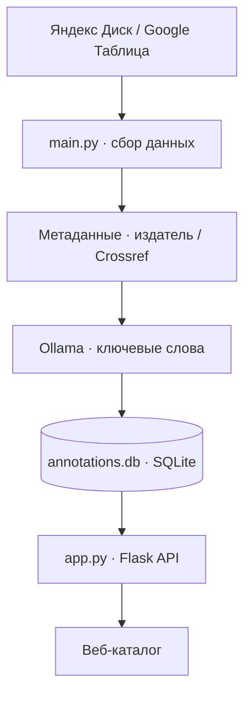

<div align="center">

# 📚 Ollama Publications

### Каталог научных публикаций с локальным искусственным интеллектом

**Яндекс Диск / Google Sheets → Python → Ollama → SQLite → Flask**


*Автоматический сбор аннотаций, анализ научных статей и удобный веб-каталог.*

</div>

---

## ✨ Возможности

- 📥 **Импорт** TXT-аннотаций из публичной папки Яндекс Диска или записей Google Таблицы.
- 🔎 **Метаданные статей**: определение названия и реальных авторов через сайт издателя или Crossref.
- 🤖 **Локальная Ollama**: выделение 5–8 ключевых слов по тексту статьи с обработкой длинных документов по частям.
- 🗄️ **SQLite**: хранение аннотаций, авторов, дат, ссылок и ключевых слов.
- 🌐 **Flask-сайт**: каталог публикаций, поиск по русскому и английскому тексту, фильтры по автору и дате, сортировка.
- 🔄 **Обновление данных**: повторная обработка только новых или изменившихся записей и журнал ошибок.

> Модель Ollama работает локально. Для скачивания документов и библиографических сведений требуется интернет. Просмотр уже сохранённых статей не требует запуска Ollama.

## 🧩 Как устроен проект



## 🛠️ Технологии

| Технология | Назначение |
|---|---|
| Python 3.10+ | Загрузка, обработка и сохранение данных |
| Ollama (`qwen2.5:7b` по умолчанию) | Анализ текстов и ключевые слова |
| Crossref / сайты издателей | Библиографические сведения |
| SQLite | База публикаций |
| Flask | Веб-сервер и JSON API |
| Bootstrap, HTML, CSS, JavaScript | Интерфейс каталога |

## 🚀 Установка и запуск на Windows

**1.** Установите [Python 3.10+](https://www.python.org/downloads/) и [Ollama](https://ollama.com/download).

**2.** Скачайте репозиторий (**Code → Download ZIP**) и распакуйте его. Откройте PowerShell в папке проекта.

**3.** Дважды щёлкните `install_windows.bat` или выполните вручную:

```powershell
py -3 -m pip install -r requirements.txt
Copy-Item .env.example .env
```

Если `.env` уже существует, не перезаписывайте его.

**4.** Настройте `.env`:

```dotenv
# Ссылка на публичную папку TXT-файлов
YANDEX_PUBLIC_URL=https://disk.yandex.ru/d/YOUR_FOLDER

# Локальная языковая модель
OLLAMA_BASE_URL=http://127.0.0.1:11434
OLLAMA_MODEL=qwen2.5:7b

# База данных
DB_PATH=annotations.db
```

Для старого режима Google Таблицы оставьте `YANDEX_PUBLIC_URL` пустым и укажите `GOOGLE_SHEET_URL` и `GOOGLE_SHEET_GID`.

**5.** Подготовьте и проверьте Ollama:

```powershell
ollama pull qwen2.5:7b
ollama list
irm http://127.0.0.1:11434/api/tags
```

Если Ollama уже запущена в фоне, повторный `ollama serve` не нужен.

**6.** Обновите базу: запустите `update_annotations_windows.bat` или выполните:

```powershell
py -3 main.py
```

**7.** Откройте отдельное окно PowerShell и запустите сайт через `start_windows.bat` или:

```powershell
py -3 app.py
```

Перейдите на **http://127.0.0.1:5000**.

**Важно:** `main.py` импортирует статьи, а `app.py` показывает сайт. Это два независимых процесса. Сайт работает с уже заполненной базой без Ollama.

## 📝 Формат TXT-аннотации

Каждый TXT — отдельная публикация. Файлы должны иметь кодировку UTF-8.

```text
Выполнил: Иванов Иван
Дата создания: 19.11.2026
Ссылка на статью: https://arxiv.org/abs/2508.04721
Название статьи: Название научной публикации
Аннотация:
Здесь находится исходный текст аннотации.
Он может занимать несколько строк.
```

| Поле | Описание |
|---|---|
| `Выполнил` / `Выполнила` | Автор **аннотации**, не статьи |
| `Дата создания` | Дата аннотации; необязательна, при отсутствии сохраняется пустая строка |
| `Ссылка на статью` | Страница оригинальной публикации |
| `Название статьи` | Резервное название для поиска метаданных |
| `Статья` | Необязательная прямая ссылка на PDF |
| `Аннотация` | Полный оригинальный текст |

Имена TXT-файлов должны быть уникальными и стабильными: программа использует их для определения записей при повторном импорте.

## ⌨️ Команды

| Команда | Что делает |
|---|---|
| `py -3 main.py` | Обрабатывает новые и изменённые записи |
| `py -3 main.py --list` | Выводит статьи и ошибки из базы |
| `py -3 main.py --force` | Принудительно обновляет все записи |
| `py -3 main.py --watch 600` | Проверяет обновления каждые 10 минут |
| `py -3 app.py` | Запускает локальный сайт |
| `py -3 -m unittest discover -s tests -v` | Тестирует обработчик |
| `py -3 -m unittest test_app -v` | Тестирует сайт |

Остановка процесса: `Ctrl+C`.

## 🌐 HTTP API

| Метод | URL | Результат |
|---|---|---|
| `GET` | `/` | Главная страница |
| `GET` | `/api/articles` | Публикации в JSON |
| `GET` | `/api/articles?q=робот` | Поиск по содержимому |
| `GET` | `/api/articles?author=Иванов%20Иван` | Фильтр по автору аннотации |
| `GET` | `/api/articles?date_from=2026-01-01&date_to=2026-12-31` | Фильтр по датам |
| `GET` | `/api/articles/45` | Одна статья по ID |
| `GET` | `/article/45` | HTML-страница статьи |

Сортировка: `sort=date_desc`, `date_asc` или `author`.

## 📁 Структура проекта

```text
ollama_publications/
├── main.py                         # Импорт и анализ статей
├── app.py                          # Flask-сервер и API
├── requirements.txt                # Зависимости Python
├── .env.example                    # Пример настроек
├── install_windows.bat             # Установка библиотек
├── start_windows.bat               # Запуск сайта
├── update_annotations_windows.bat  # Обновление данных
├── templates/                      # HTML-страницы
├── static/
│   ├── css/style.css
│   └── js/app.js
├── tests/test_main.py              # Тесты обработки
├── test_app.py                     # Тесты сайта
└── README.md
```

`annotations.db` создаётся автоматически при первом запуске. Существующую базу можно поместить рядом с `main.py`.

## 🧯 Частые проблемы

| Ошибка | Решение |
|---|---|
| `No module named flask` | `py -3 -m pip install -r requirements.txt` |
| `ollama` не найдена | Проверьте установку Ollama и PATH |
| Ollama не отвечает | Проверьте `http://127.0.0.1:11434/api/tags` |
| Не открывается сайт | Убедитесь, что `app.py` запущен и порт 5000 свободен |
| Статьи не обновляются | Проверьте публичную ссылку, TXT и ошибки через `--list` |
| `database is locked` | Закройте незавершённые транзакции в других программах |

Если публикацию не удалось обработать, причина сохраняется в таблице `extraction_errors`. Не удаляйте файлы SQLite `-wal` и `-shm` вручную для устранения блокировки.

## 🔐 Перед публикацией на GitHub

- Не публикуйте личный `.env`: он уже исключён в `.gitignore`.
- **Не добавляйте `annotations.db` в публичный репозиторий**, пока не убедитесь, что можно раскрывать хранящиеся в ней аннотации и данные авторов. Рекомендуется добавить `annotations.db`, `annotations.db-wal` и `annotations.db-shm` в `.gitignore`.
- Импорт работает с открытыми по ссылке материалами; доступ к закрытым источникам без авторизации не предусмотрен.
- Встроенный Flask-сервер предназначен для локального запуска, не для публичного продакшен-хостинга.

---

<div align="center">

**Ollama Publications** — от научной аннотации до интеллектуального каталога 🚀

</div>
